# ECE2132 Data Structures & Algorithms Lab — To-write (record)

<div class="sub">For each experiment: Aim · Theory (summary) · Algorithm · Flowchart · Program · Result. Programs are the corrected, compiled and tested versions; outputs are from real runs on the manual's sample inputs. Software used (all experiments): VS Code / Code::Blocks / Dev-C++ with the GCC/G++ compiler, Windows/Linux.</div>

| Exp | Title |
|---|---|
| 1 | Pointers |
| 2 | Pointer arithmetic |
| 3 | Insertion in an array (beginning, any position, end) |
| 4 | Deletion from an array (beginning, any position, end) |
| 5 | Matrix multiplication using modular programming |
| 6 | Matrix transpose using modular programming |
| 7 | Insertion sort and its performance |
| 8 | Quick sort and comparison with other sorting techniques |
| 9 | Stack using an array *(probable: no Exp 9 file was uploaded; confirm before writing)* |
| 10 | Queue using an array (enqueue, dequeue) |
| 11 | Singly linked list (insertion, deletion, traversal) |
| 12 | Circular linked list (insertion, deletion, traversal) |

## Experiment 1 — Pointers {.exp}

### Aim
To write a program in C++ to implement pointers: store the address of a variable in a pointer and access the variable through the pointer.

### Theory
A pointer is a variable that stores the address of another variable. `&` gives a variable's address; `*` gives the value at the address a pointer holds. If `ptr = &number`, then `*ptr` equals `number`. Time and space: O(1).

### Algorithm
1. Start.
2. Declare an integer variable `number = 25`.
3. Declare an integer pointer `ptr`.
4. Store the address of `number` in `ptr` (`ptr = &number`).
5. Display the value of `number` and its address `&number`.
6. Display the address stored in `ptr` and the value `*ptr`.
7. Stop.

### Flowchart

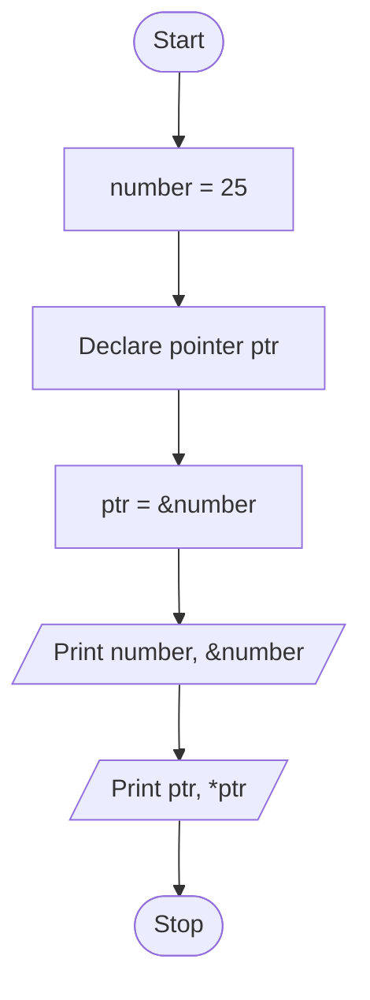

### Program
[[code:e01_pointers.cpp]]

### Result
The program was executed successfully. The pointer stored the address of `number` (the same value as `&number`), and dereferencing it (`*ptr`) gave the value 25.

[[run:e01]]

## Experiment 2 — Pointer arithmetic {.exp}

### Aim
To write a program in C++ to implement pointer arithmetic by performing increment, decrement and addition operations on a pointer.

### Theory
Pointer arithmetic moves a pointer by whole elements, not bytes: for an `int` pointer, `ptr++` moves to the next element (+4 bytes), `ptr--` back one, `ptr + 2` forward two. It works because array elements are contiguous, and `arr` is the address of `arr[0]`. Time and space: O(1).

### Algorithm
1. Start.
2. Declare an integer array `arr[5] = {10, 20, 30, 40, 50}`.
3. Declare a pointer `ptr` and point it to the first element (`ptr = arr`).
4. Display the address in `ptr` and the value `*ptr`.
5. Increment the pointer (`ptr++`); display the address and value.
6. Decrement the pointer (`ptr--`); display the address and value.
7. Add 2 to the pointer (`ptr = ptr + 2`); display the address and value.
8. Stop.

### Flowchart

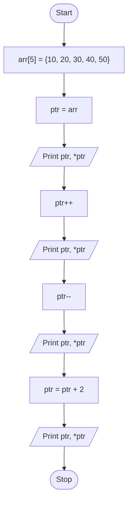

### Program
[[code:e02_pointer_arithmetic.cpp]]

### Result
The program was executed successfully. Each increment moved the pointer by 4 bytes (one int): the values read were 10, 20, 10 and 30 at addresses base, base + 4, base and base + 8.

[[run:e02]]

## Experiment 3 — Insertion in an array (beginning, any position, end) {.exp}

### Aim
To write a program in C++ to insert an element into an array at the beginning, at any specified position, and at the end.

### Theory
Array elements are contiguous, so before inserting, a gap is made by shifting elements one place right, starting from the last. Beginning: shift all, O(n). Any position: shift from index pos−1 onward, O(n). End: no shift, O(1). Then n = n + 1. A full array cannot take more (overflow).

### Algorithm
1. Start.
2. Declare `arr[100]`; read n and the n elements.
3. If n ≥ 100, display "Array is full" and stop.
4. Display the menu and read the choice.
5. If choice = 1 (beginning): read value; for i = n down to 1, set arr[i] = arr[i−1]; set arr[0] = value.
6. If choice = 2 (position): read pos; if pos < 1 or pos > n+1, display "Invalid position" and stop; read value; for i = n down to pos, set arr[i] = arr[i−1]; set arr[pos−1] = value.
7. If choice = 3 (end): read value; set arr[n] = value.
8. Set n = n + 1.
9. Display the updated array.
10. Stop.

### Flowchart

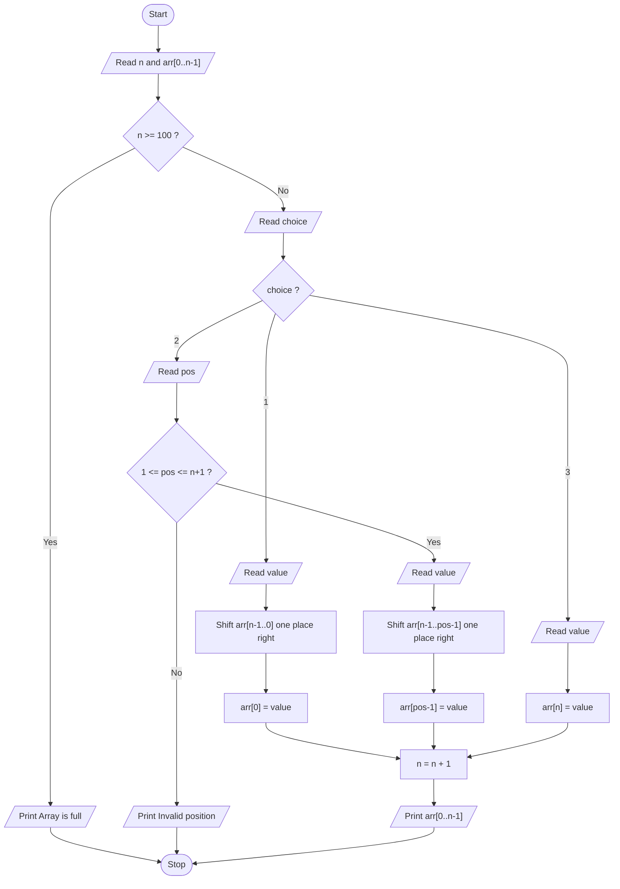

### Program
[[code:e03_array_insert.cpp]]

### Result
The program was executed successfully. For 10 20 30 40 50: inserting 5 at the beginning gave 5 10 20 30 40 50; inserting 25 at position 3 gave 10 20 25 30 40 50; inserting 60 at the end gave 10 20 30 40 50 60.

[[run:e03_pos]]

## Experiment 4 — Deletion from an array (beginning, any position, end) {.exp}

### Aim
To write a program in C++ to delete an element from an array at the beginning, at any specified position, and at the end.

### Theory
Deleting leaves a gap, which is closed by shifting the following elements one place left. Beginning: O(n). Any position: O(n). End: no shift, O(1). Then n = n − 1. Deleting from an empty array is underflow.

### Algorithm
1. Start.
2. Declare `arr[100]`; read n and the n elements.
3. If n ≤ 0, display "Array is empty" and stop.
4. Display the menu and read the choice.
5. If choice = 1 (beginning): display arr[0]; for i = 0 to n−2, set arr[i] = arr[i+1].
6. If choice = 2 (position): read pos; if pos < 1 or pos > n, display "Invalid position" and stop; display arr[pos−1]; for i = pos−1 to n−2, set arr[i] = arr[i+1].
7. If choice = 3 (end): display arr[n−1].
8. Set n = n − 1.
9. Display the updated array.
10. Stop.

### Flowchart

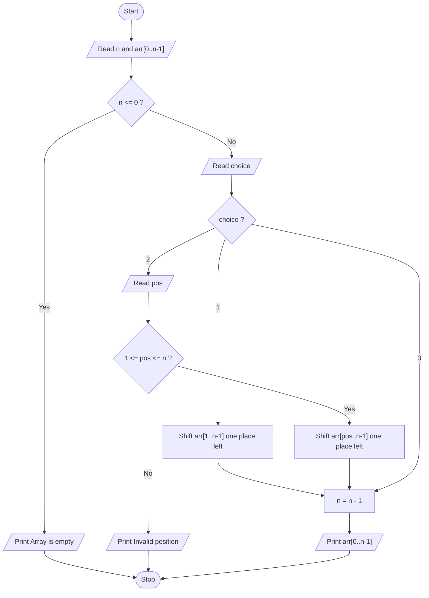

### Program
[[code:e04_array_delete.cpp]]

### Result
The program was executed successfully. For 10 20 30 40 50: deleting at the beginning gave 20 30 40 50; deleting position 3 (element 30) gave 10 20 40 50; deleting at the end gave 10 20 30 40.

[[run:e04_pos]]

## Experiment 5 — Matrix multiplication using modular programming {.exp}

### Aim
To write a program in C++ to implement matrix multiplication using modular programming, with separate functions for input, multiplication and display.

### Theory
A (r1 × c1) and B (r2 × c2) can be multiplied only if c1 = r2. The result is r1 × c2, with C[i][j] = Σ A[i][k] × B[k][j]. Three nested loops give O(n³) time. Modular programming splits the work into `inputMatrix()`, `multiplyMatrix()` and `displayMatrix()`, called from `main()`.

### Algorithm
1. Start.
2. Declare matrices A, B, C of size 10 × 10.
3. Read the order r1 × c1 of A and r2 × c2 of B.
4. If c1 ≠ r2, display "Matrix multiplication not possible" and stop.
5. Call `inputMatrix()` to read A and then B.
6. Call `multiplyMatrix()`: for each i (0 to r1−1) and j (0 to c2−1), set C[i][j] = 0, then for k = 0 to c1−1 add A[i][k] × B[k][j] to C[i][j].
7. Call `displayMatrix()` to display C (r1 × c2).
8. Stop.

### Flowchart

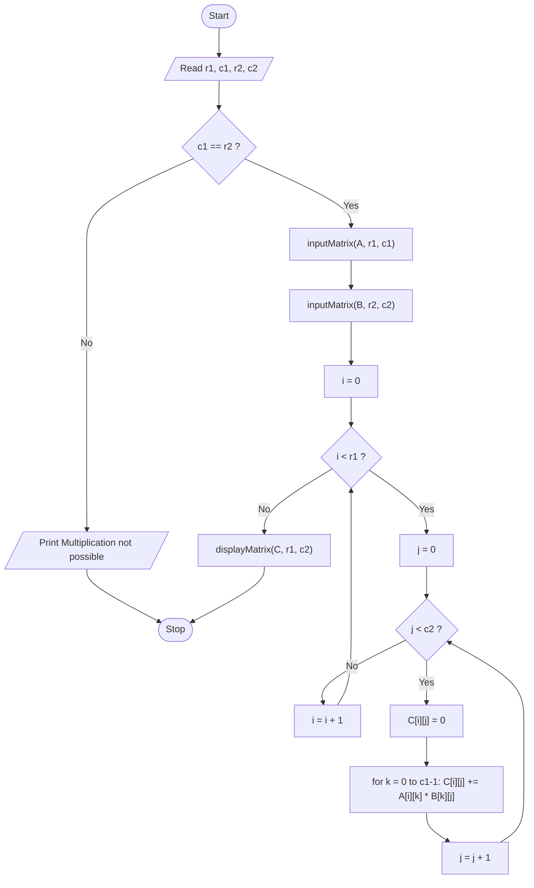

### Program
[[code:e05_matrix_multiply.cpp]]

### Result
The program was executed successfully. [[1, 2], [3, 4]] × [[5, 6], [7, 8]] = [[19, 22], [43, 50]], computed with separate functions for input, multiplication and display.

[[run:e05]]

## Experiment 6 — Matrix transpose using modular programming {.exp}

### Aim
To write a program in C++ to find the transpose of a matrix using modular programming, with separate functions for input, transpose and display.

### Theory
The transpose swaps rows and columns: an m × n matrix A gives an n × m matrix T with T[j][i] = A[i][j]. Time and space: O(m × n). Separate functions: `inputMatrix()`, `transposeMatrix()`, `displayMatrix()`.

### Algorithm
1. Start.
2. Declare matrices A and T of size 10 × 10.
3. Read the number of rows and columns of A.
4. Call `inputMatrix()` to read A.
5. Call `transposeMatrix()`: for each i (0 to rows−1) and j (0 to cols−1), set T[j][i] = A[i][j].
6. Call `displayMatrix(A, rows, cols)` to display the original matrix.
7. Call `displayMatrix(T, cols, rows)` to display the transpose.
8. Stop.

### Flowchart

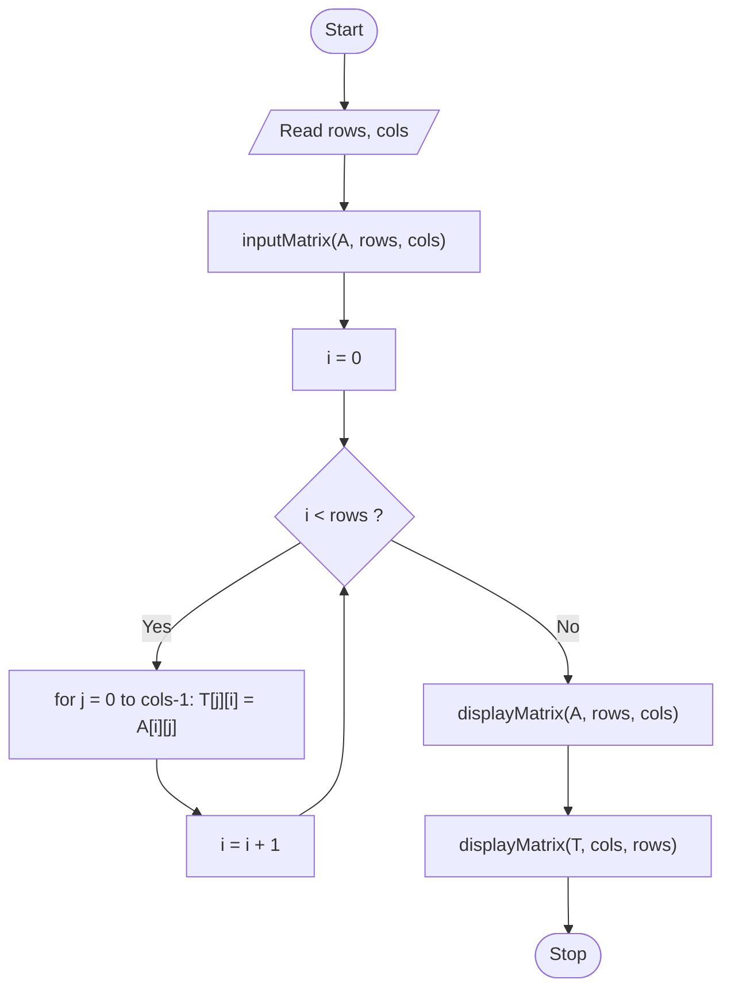

### Program
[[code:e06_matrix_transpose.cpp]]

### Result
The program was executed successfully. The 2 × 3 matrix [[1, 2, 3], [4, 5, 6]] gave the 3 × 2 transpose [[1, 4], [2, 5], [3, 6]].

[[run:e06]]

## Experiment 7 — Insertion sort and its performance {.exp}

### Aim
To write a program in C++ to sort an array of integers in ascending order using insertion sort and analyse its performance.

### Theory
Insertion sort keeps a sorted left part. Each pass takes the next element as the key, shifts larger sorted elements one place right, and inserts the key into the gap (n − 1 passes). Best case O(n) (already sorted); average and worst O(n²) (reverse sorted). Space O(1); in-place and stable.

### Algorithm
1. Start.
2. Read n and the n elements of the array.
3. For i = 1 to n − 1:
   a. key = arr[i], j = i − 1.
   b. While j ≥ 0 and arr[j] > key: arr[j+1] = arr[j], j = j − 1.
   c. arr[j+1] = key.
4. Display the sorted array.
5. Stop.

### Flowchart

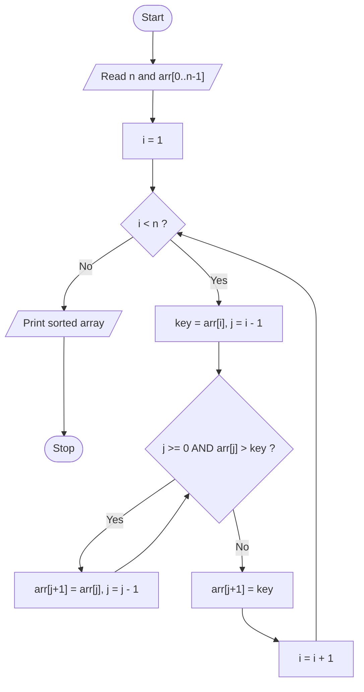

### Program
[[code:e07_insertion_sort.cpp]]

### Result
The program was executed successfully. The array 5 2 4 6 1 3 was sorted to 1 2 3 4 5 6 in 5 passes (9 shifts, 12 comparisons). Performance: best case O(n) (sorted input: 5 comparisons for n = 6), average and worst case O(n²) (reverse input: 15 comparisons = n(n−1)/2), space O(1).

[[run:e07]]

## Experiment 8 — Quick sort and comparison with other sorting techniques {.exp}

### Aim
To write a program in C++ to sort an array of integers using quick sort and compare its performance with other sorting techniques (bubble sort, selection sort, insertion sort).

### Theory
Quick sort (divide and conquer) picks a pivot (the last element) and partitions the array: smaller elements go to the left, larger to the right, and the pivot lands in its final position. Both sides are then sorted recursively. Best/average O(n log n), worst O(n²) (sorted input), space O(log n). Bubble, selection and insertion sort are O(n²); execution times are compared using `clock()`.

### Algorithm
1. Start.
2. Read n and the n elements into `original[]`.
3. For each of quick, bubble, selection and insertion sort: copy `original[]` into `work[]`, sort `work[]`, and display it.
4. **quickSort(arr, low, high):** if low < high: pi = partition(arr, low, high); quickSort(arr, low, pi − 1); quickSort(arr, pi + 1, high).
5. **partition(arr, low, high):** pivot = arr[high], i = low − 1; for j = low to high − 1: if arr[j] < pivot then i = i + 1 and swap arr[i], arr[j]. Finally swap arr[i+1], arr[high] and return i + 1.
6. Fill `original[]` with 10 000 random numbers. For each algorithm: copy, record `start = clock()`, sort, record `end = clock()`, display (end − start) in ms.
7. Stop.

### Flowchart

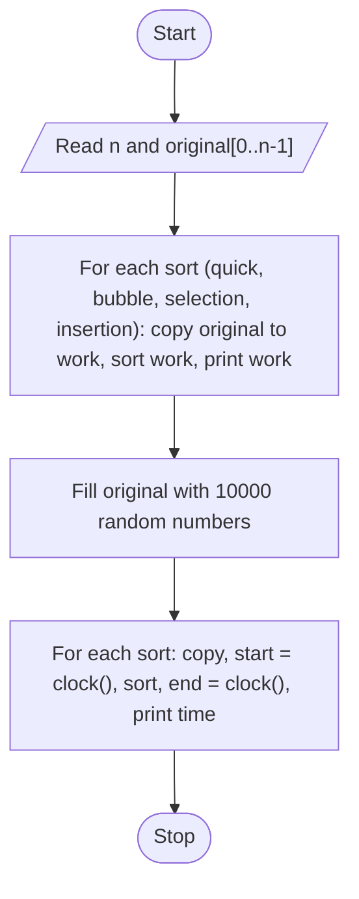

<div class="flows">

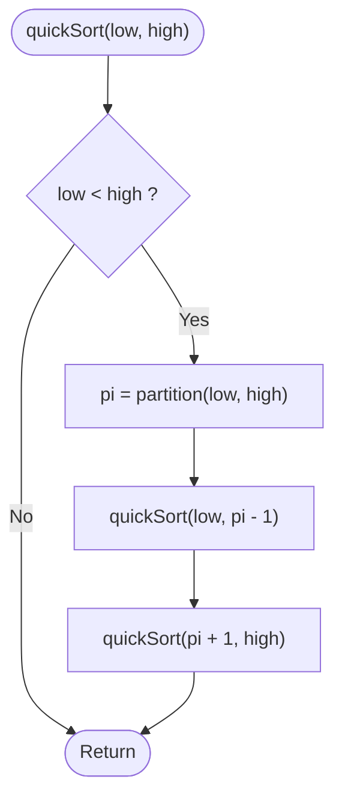

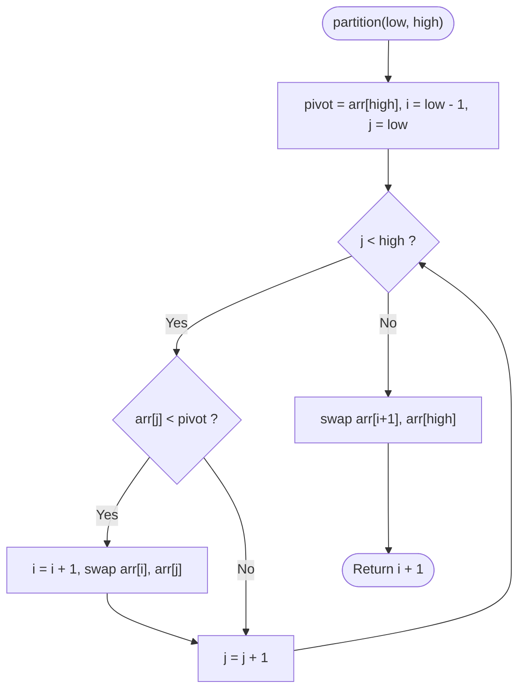

</div>

### Program
[[code:e08_sort_compare.cpp]]

### Result
The program was executed successfully. The array 10 7 8 9 1 5 was sorted to 1 5 7 8 9 10 by all four algorithms. On 10 000 random numbers, quick sort was the fastest by far (about 1 ms), while bubble, selection and insertion sort took tens to over a hundred milliseconds, consistent with O(n log n) vs O(n²). Times vary from machine to machine.

[[run:e08_compare]]

## Experiment 9 — Stack using an array *(probable)* {.exp}

:::note Check first
No Exp 9 file was uploaded. Exp 10's figures say "Operation on Stack", so Exp 9 is most likely Stack. Confirm with a classmate before writing this one.
:::

### Aim
To write a program in C++ to implement a stack using an array with push, pop, peek and display operations.

### Theory
A stack inserts (push) and deletes (pop) at one end, the top: LIFO (Last In, First Out). top = −1 means empty. Overflow: push when top = MAX − 1. Underflow: pop when top = −1. Push, pop and peek are O(1).

### Algorithm
1. Start. Declare `stackArr[MAX]`, top = −1.
2. Display the menu (Push, Pop, Peek, Display, Exit) and read the choice.
3. **Push:** if top = MAX − 1, display "Stack Overflow"; else top = top + 1, stackArr[top] = value.
4. **Pop:** if top = −1, display "Stack Underflow"; else display stackArr[top], top = top − 1.
5. **Peek:** if top = −1, display "Stack is empty"; else display stackArr[top].
6. **Display:** print stackArr[top] down to stackArr[0].
7. Repeat from step 2 until Exit is chosen.
8. Stop.

### Flowchart

<div class="flows">

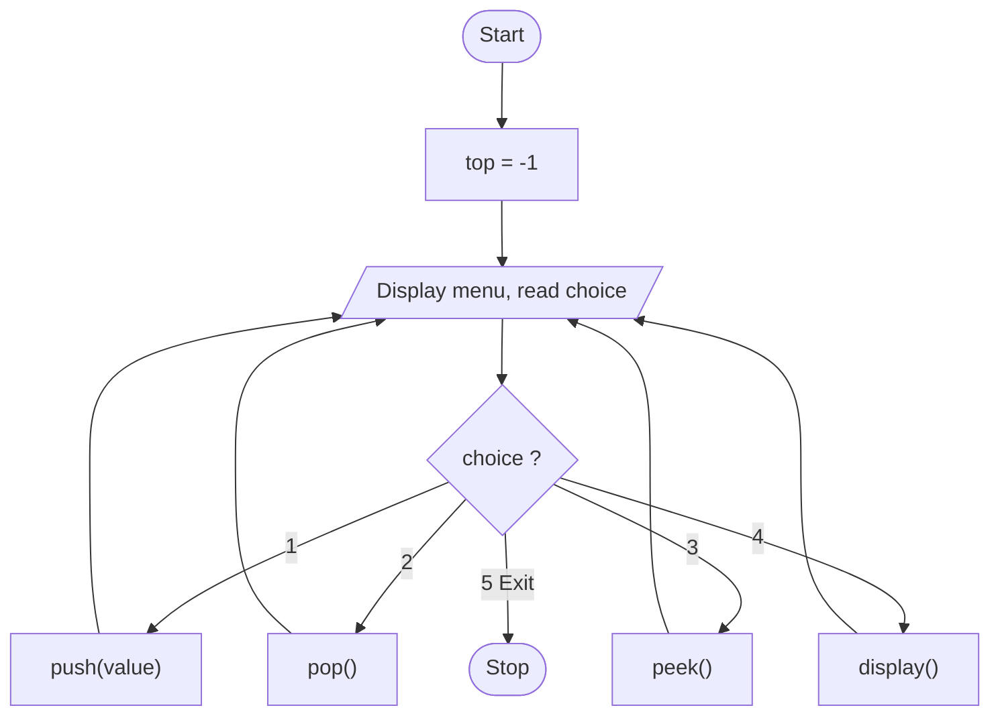

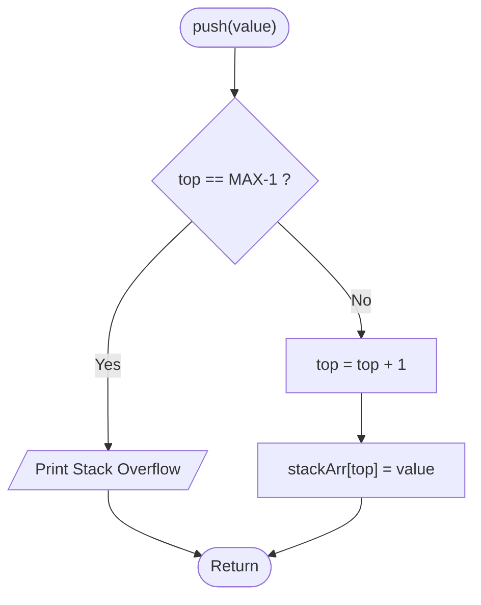

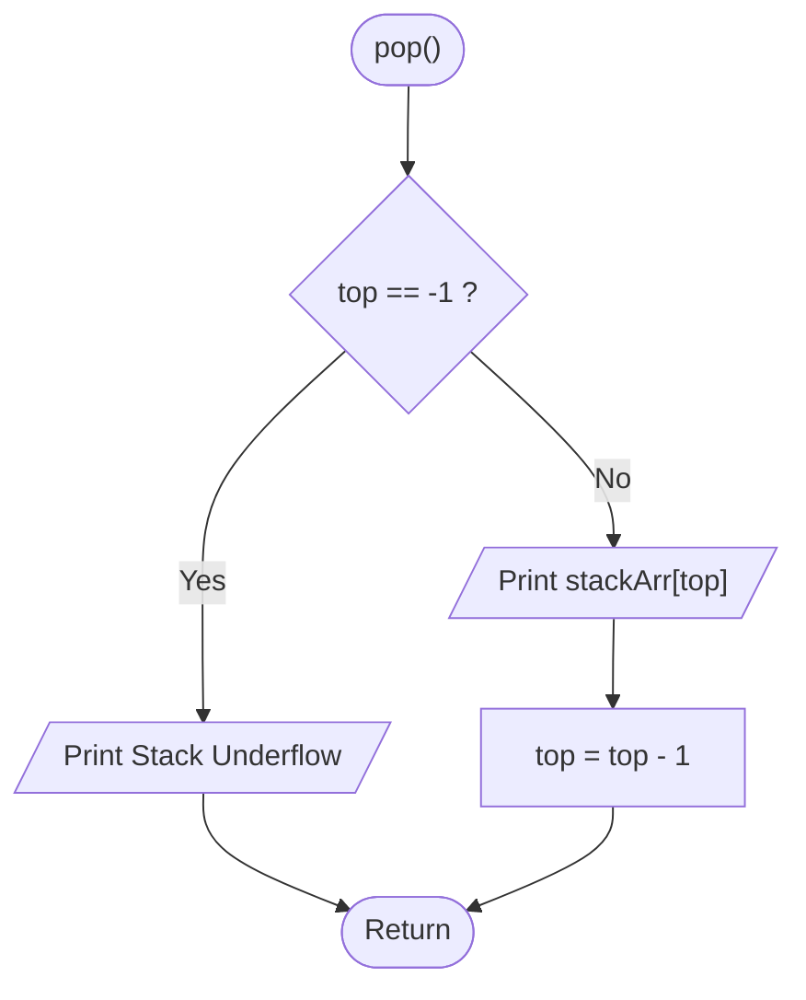

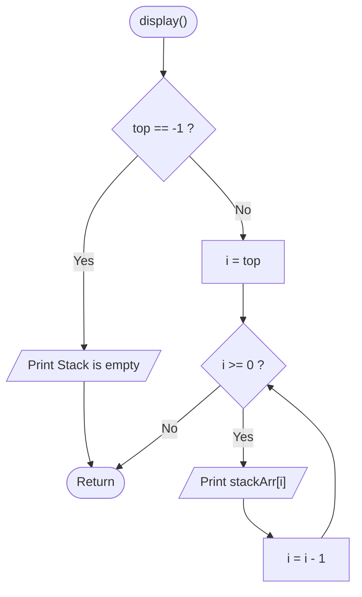

</div>

### Program
[[code:e09_stack.cpp]]

### Result
The program was executed successfully. 10, 20 and 30 were pushed and popped in the order 30, 20, 10, confirming LIFO. Overflow (sixth push with MAX = 5) and underflow (pop from an empty stack) were detected.

[[run:e09]]

## Experiment 10 — Queue using an array (enqueue, dequeue) {.exp}

### Aim
To write a program in C++ to implement a queue using an array and perform enqueue and dequeue operations.

### Theory
A queue inserts at the rear (enqueue) and deletes from the front (dequeue): FIFO (First In, First Out). front = rear = −1 means empty. Overflow: rear = MAX − 1. Underflow: front = −1. Enqueue and dequeue are O(1). In a linear queue, slots freed at the front are not reused.

### Algorithm
1. Start. Declare `queueArr[MAX]`, front = −1, rear = −1.
2. Display the menu (Enqueue, Dequeue, Display, Exit) and read the choice.
3. **Enqueue:** if rear = MAX − 1, display "Queue Overflow"; else if front = −1 set front = 0; rear = rear + 1; queueArr[rear] = value.
4. **Dequeue:** if front = −1, display "Queue Underflow"; else display queueArr[front]; if front = rear set front = rear = −1, else front = front + 1.
5. **Display:** if front = −1, display "Queue is empty"; else print queueArr[front … rear].
6. Repeat from step 2 until Exit is chosen.
7. Stop.

### Flowchart

<div class="flows">

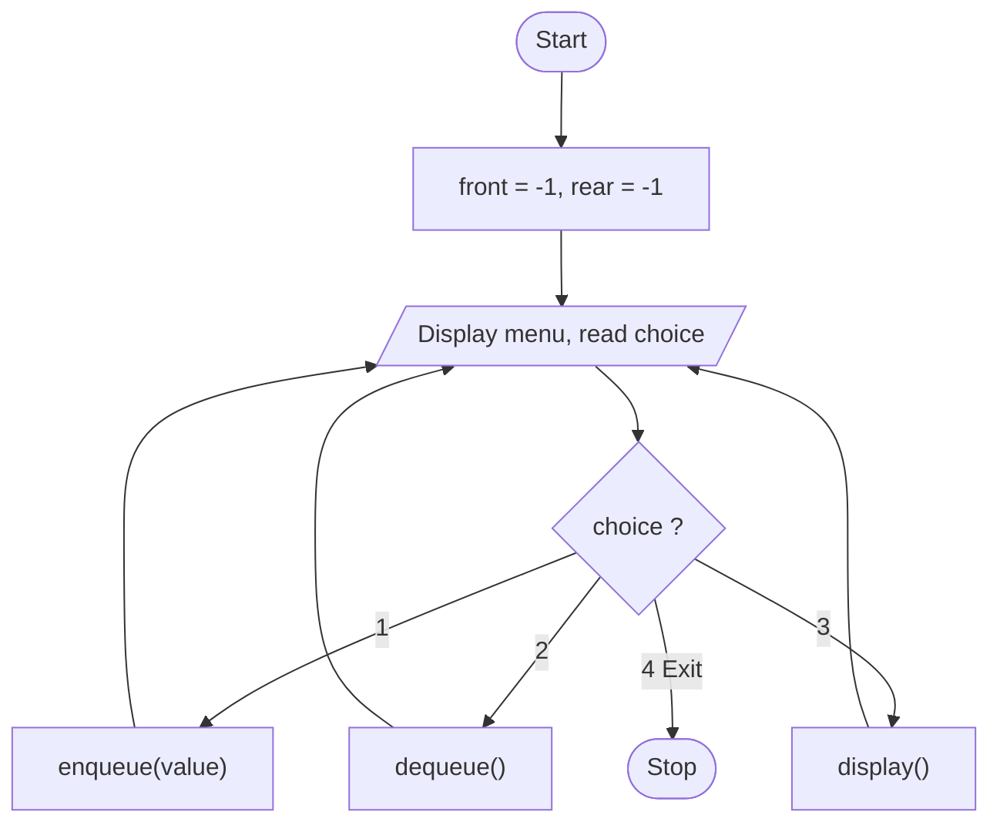

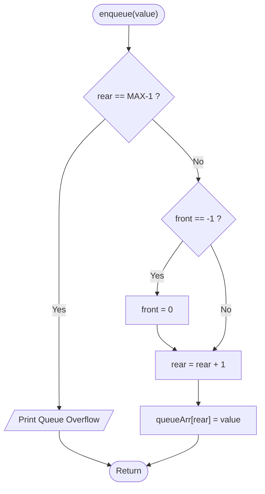

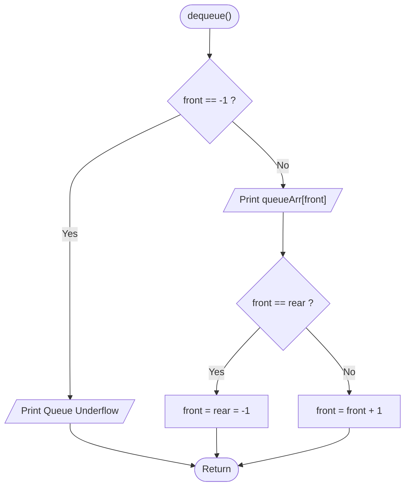

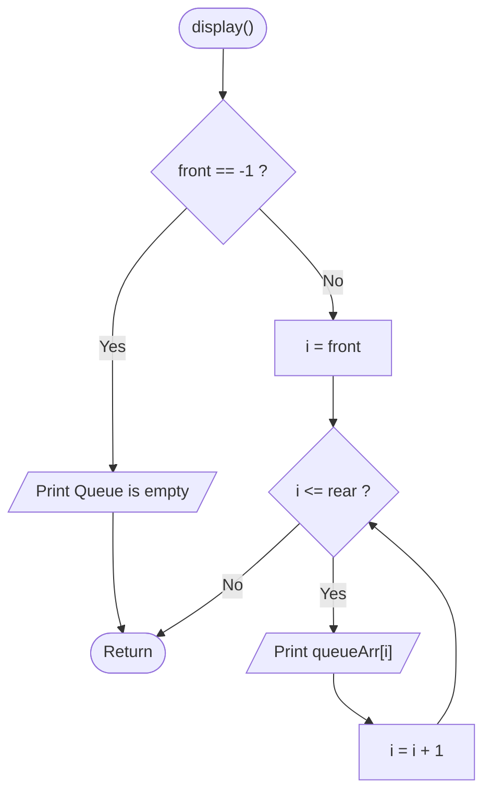

</div>

### Program
[[code:e10_queue.cpp]]

### Result
The program was executed successfully. 10, 20 and 30 were enqueued (display: 10 20 30); dequeue removed 10 (display: 20 30), confirming FIFO. Overflow and underflow conditions were handled.

[[run:e10]]

## Experiment 11 — Singly linked list (insertion, deletion, traversal) {.exp}

### Aim
To write a program in C++ to implement a singly linked list and perform insertion, deletion and traversal operations.

### Theory
A singly linked list is a chain of nodes, each holding data and a `next` pointer. `head` points to the first node, and the last node points to NULL. Nodes are created with `new` and freed with `delete`. Insert at end O(n), delete at beginning O(1), traversal O(n).

### Algorithm
1. Start. Define `struct Node { int data; Node *next; }`; head = NULL.
2. Display the menu (Insert, Delete, Traverse, Exit) and read the choice.
3. **Insert (end):** create newNode with data = value, next = NULL. If head = NULL, head = newNode; else temp = head, move temp until temp→next = NULL, then temp→next = newNode.
4. **Delete (beginning):** if head = NULL, display "List is empty"; else temp = head, display temp→data, head = head→next, delete temp.
5. **Traverse:** if head = NULL, display "List is empty"; else temp = head; while temp ≠ NULL, display temp→data and set temp = temp→next.
6. Repeat from step 2 until Exit is chosen.
7. Stop.

### Flowchart

<div class="flows">

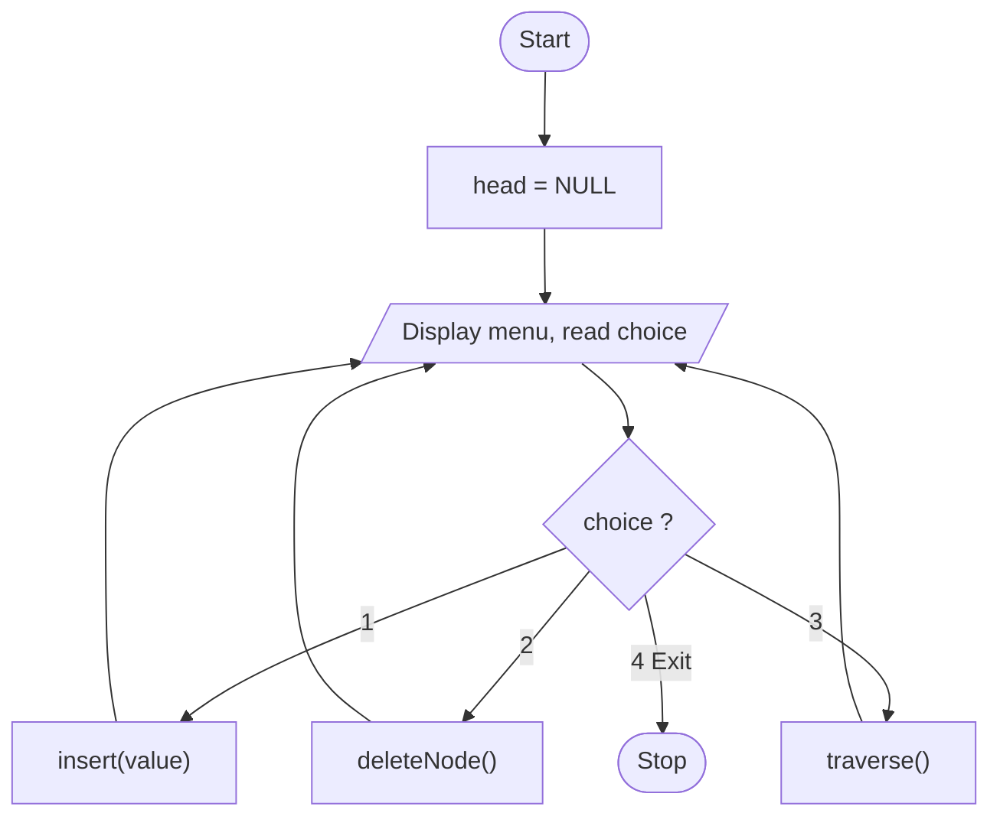

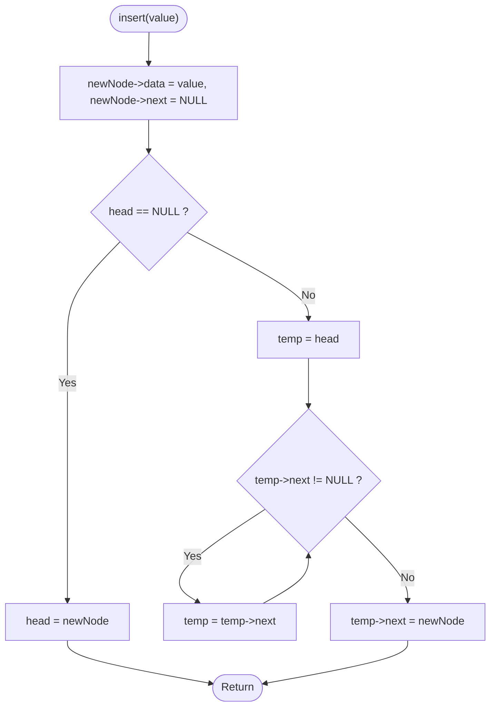

```mermaid
flowchart TD
A(["deleteNode()"]) --> B{"head == NULL ?"}
B -- Yes --> C[/"Print List is empty"/] --> R(["Return"])
B -- No --> D["temp = head"] --> E["head = head->next"] --> F["delete temp"] --> R
```

```mermaid
flowchart TD
A(["traverse()"]) --> B{"head == NULL ?"}
B -- Yes --> C[/"Print List is empty"/] --> R(["Return"])
B -- No --> D["temp = head"] --> E{"temp != NULL ?"}
E -- Yes --> F[/"Print temp->data"/] --> G["temp = temp->next"] --> E
E -- No --> R
```

</div>

### Program
[[code:e11_singly_linked_list.cpp]]

### Result
The program was executed successfully. Inserting 10, 20 and 30 gave the list 10 → 20 → 30; deleting from the beginning removed 10, leaving 20 → 30.

[[run:e11]]

## Experiment 12 — Circular linked list (insertion, deletion, traversal) {.exp}

### Aim
To write a program in C++ to implement a circular linked list and perform insertion, deletion and traversal operations.

### Theory
In a circular linked list the last node points back to head instead of NULL (a single node points to itself). The last node is the one with `next == head`, and traversal uses a do-while loop until it returns to head. Insert at end O(n), delete at beginning O(n) (the last node must be re-linked), traversal O(n).

### Algorithm
1. Start. Define `struct Node { int data; Node *next; }`; head = NULL.
2. Display the menu (Insert, Delete, Traverse, Exit) and read the choice.
3. **Insert (end):** create newNode with data = value. If head = NULL, head = newNode and newNode→next = head; else move temp from head until temp→next = head, then temp→next = newNode and newNode→next = head.
4. **Delete (beginning):** if head = NULL, display "List is empty"; else if head→next = head, delete head and set head = NULL; else find last (last→next = head), temp = head, head = head→next, last→next = head, delete temp.
5. **Traverse:** if head = NULL, display "List is empty"; else temp = head; do { display temp→data; temp = temp→next } while temp ≠ head.
6. Repeat from step 2 until Exit is chosen.
7. Stop.

### Flowchart

<div class="flows">

```mermaid
flowchart TD
A(["Start"]) --> B["head = NULL"]
B --> C[/"Display menu, read choice"/]
C --> D{"choice ?"}
D -- "1" --> O0["insert(value)"] --> C
D -- "2" --> O1["deleteNode()"] --> C
D -- "3" --> O2["traverse()"] --> C
D -- "4 Exit" --> S(["Stop"])
```

```mermaid
flowchart TD
A(["insert(value)"]) --> B["newNode->data = value"]
B --> C{"head == NULL ?"}
C -- Yes --> D["head = newNode, newNode->next = head"] --> R(["Return"])
C -- No --> E["temp = head"] --> F{"temp->next != head ?"}
F -- Yes --> G["temp = temp->next"] --> F
F -- No --> H["temp->next = newNode, newNode->next = head"] --> R
```

```mermaid
flowchart TD
A(["deleteNode()"]) --> B{"head == NULL ?"}
B -- Yes --> C[/"Print List is empty"/] --> R(["Return"])
B -- No --> D{"head->next == head ?"}
D -- Yes --> E["delete head, head = NULL"] --> R
D -- No --> F["last = head; move last until last->next == head"]
F --> G["temp = head, head = head->next"] --> H["last->next = head, delete temp"] --> R
```

```mermaid
flowchart TD
A(["traverse()"]) --> B{"head == NULL ?"}
B -- Yes --> C[/"Print List is empty"/] --> R(["Return"])
B -- No --> D["temp = head"] --> E[/"Print temp->data"/] --> F["temp = temp->next"] --> G{"temp != head ?"}
G -- Yes --> E
G -- No --> R
```

</div>

### Program
[[code:e12_circular_linked_list.cpp]]

### Result
The program was executed successfully. Inserting 10, 20 and 30 gave the circular list 10 → 20 → 30 → (back to 10); deleting from the beginning removed 10, leaving 20 → 30 → (back to 20). The last node always pointed back to head.

[[run:e12]]
